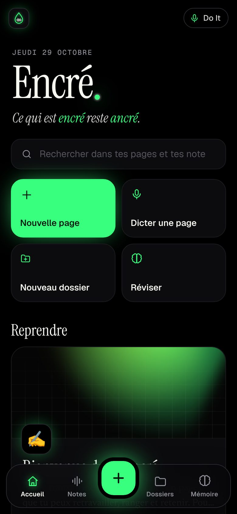
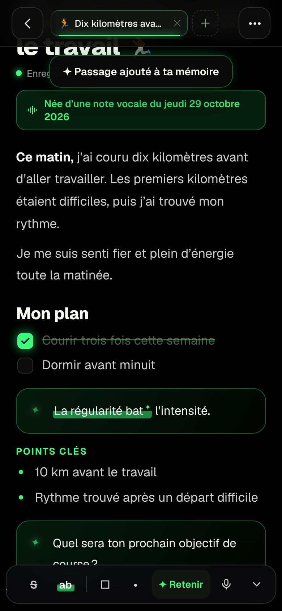
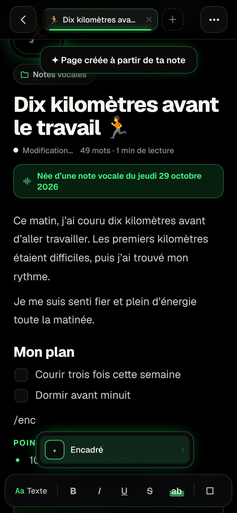
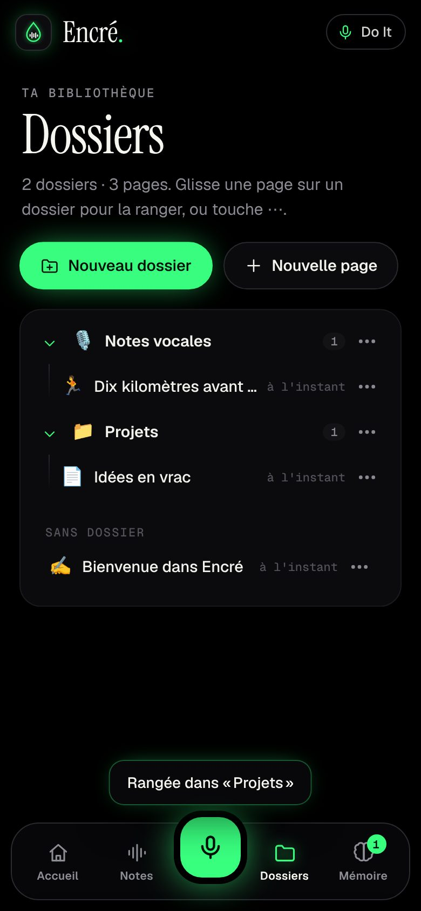
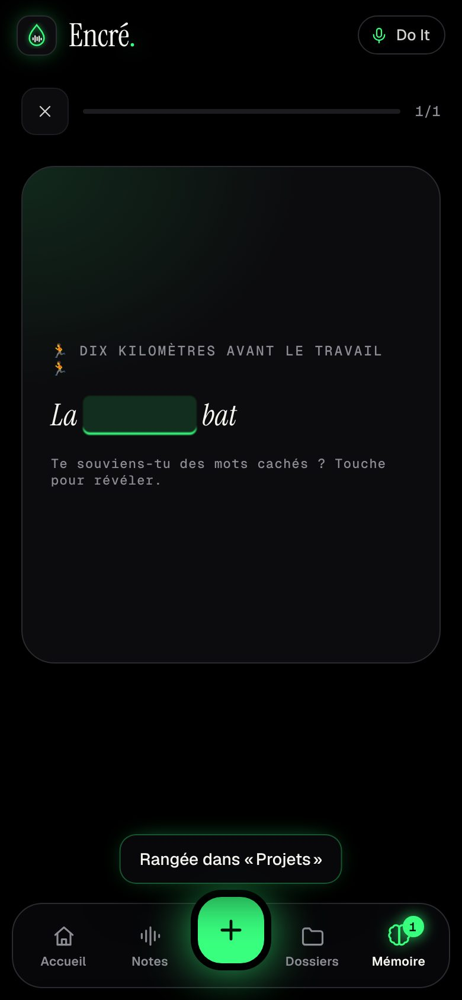

# Do It · De l'oral à l'écrit

> Les paroles s'envolent. **Les tiennes restent.**

**Ouvrir Do It : https://pierrernrd04-ai.github.io/Vous-/do-it/** · **Encré : https://pierrernrd04-ai.github.io/Vous-/do-it/encre/** (sur téléphone : « Ajouter à l'écran d'accueil »)

Version Netlify d'origine : https://do-it-journal.netlify.app (les notes enregistrées sur une adresse ne sont pas visibles sur l'autre : passe par Bilan › Réglages › Sauvegarde puis Importer).

Tu appuies sur l'orbe et tu racontes ta journée, ton sport, tes soirées, ton moral, en vrac et comme ça vient. Do It retranscrit ce que tu dis, puis l'IA (Claude) le réécrit en un texte net : grammaire et syntaxe corrigées, « euh », « en fait » et « du coup » supprimés, répétitions et doublons retirés, idées remises dans l'ordre. Chaque récit est daté, titré, résumé et **classé par thème** (Sport, Alcool, Humeurs, Travail…). Au fil des jours, ça devient ton journal de bord.

| Parler | Écoute | Récit écrit | Journal |
| --- | --- | --- | --- |
|  |  |  |  |

| Relance | Fiche | Thèmes | Bilan |
| --- | --- | --- | --- |
|  |  |  |  |

## Ce que fait l'appli

- **Dictée en direct** : les mots s'affichent pendant que tu parles et l'orbe réagit à ta voix. La dictée se relance d'elle-même après un silence, jusqu'à ce que tu appuies sur « Terminer » (20 minutes au plus).
- **De l'oral à l'écrit** : Claude réécrit à la première personne, sans rien inventer. Trois styles au choix (Bilan › Réglages) : *Pro* (prose nette, par défaut), *Récit* (journal intime plus vivant), *Synthèse* (quelques phrases et des points clés).
- **Thèmes automatiques** : 17 thèmes connus (Humeurs, Sport, Alcool, Santé, Sommeil, Alimentation, Travail, Argent, Famille, Amour, Amis & sorties, Projets & objectifs, Loisirs & culture, Voyages, Réflexions, Gratitude, Quotidien). Si tu parles souvent d'autre chose (bricolage, voiture…), l'IA crée le thème et le réutilise ensuite. Chaque thème devient un onglet du journal.
- **Un dialogue** : après chaque récit, Do It te pose une question de relance (« Comment ton corps a-t-il récupéré après ces dix kilomètres ? »). Tu réponds à voix haute et ta réponse est fusionnée dans le même récit, qui est réécrit en entier.
- **Idées de sujet** quand tu sèches, adaptées aux thèmes dont tu parles le plus.
- **Motivation** : phrases d'encouragement, série de jours d'affilée 🔥, paliers fêtés (premier récit, 7 jours, 50 récits…).
- **Bilan** : jours d'affilée, nombre de récits, minutes racontées, mots écrits, courbe d'humeur sur 14 jours, répartition des thèmes.
- **Tout est modifiable** : titre, texte, thèmes, humeur. Tu peux aussi copier, partager, faire réécrire un récit ou le supprimer.
- **Hors-ligne** : sans réseau ou sans IA, Do It nettoie quand même la transcription (tics, répétitions, négations, ponctuation) et la classe par mots-clés. Le récit est marqué « Mode local » puis réécrit automatiquement par l'IA dès qu'elle est de nouveau joignable.
- **Ton journal reste sur ton téléphone** (IndexedDB). Seul le texte dicté part à l'IA, le temps d'être réécrit. Export Markdown, sauvegarde et import JSON dans Bilan › Réglages.
- **Appli installable** (PWA) : « Ajouter à l'écran d'accueil » sur Android et iPhone, sombre ou clair.

## Encré, l'atelier d'écriture

> Ce qui est **encré** reste **ancré**.

Encré (`/encre/`, même site que Do It) reprend toutes tes notes vocales pour que tu les travailles comme dans Notion : pages riches, dossiers, onglets, et une mémoire pour retenir l'essentiel. Fond noir, vert fluo et blanc.

| Accueil | Page | Menu « / » | Dossiers | Révision |
| --- | --- | --- | --- | --- |
|  |  |  |  |  |

- **Notes vocales** : tout ce que tu racontes dans Do It arrive ici, avec recherche et filtre par thème. Une note se modifie sur place (le journal Do It suit) ou devient une page en un geste, rangée dans le dossier « Notes vocales ».
- **Pages façon Notion** : titres, listes, cases à cocher, citations, encadrés, séparateurs. Tape `/` pour choisir un bloc, ou les raccourcis `#`, `##`, `###`, `-`, `1.`, `[]`, `>`, `!`, `---`. Gras, italique, souligné, barré, surligneur. Insertion d'une note vocale, de la date, et **dictée directement dans la page**. Sept couvertures animées, une icône par page, export Markdown.
- **Dossiers et onglets** : dossiers et sous-dossiers, glisser-déposer à la souris ou « Déplacer vers… » au doigt, pages épinglées. Les pages ouvertes restent en onglets en haut de l'écran.
- **Mémoire** : sélectionne un passage et touche **✦ Retenir**. Encré te le repropose au bon moment (demain, 3 jours, 7, 16, 35, 90) sous forme de carte à trous qui se retourne.
- **Sur ordinateur**, une barre latérale avec l'arborescence des dossiers, comme dans Notion.
- Tout reste sur l'appareil (IndexedDB), sauvegarde et import JSON en bas de l'accueil. Les deux applis partagent le site, donc les mêmes données sur un même téléphone.

## Navigateurs

La dictée utilise la reconnaissance vocale du navigateur, en français :

- **Android** : Chrome. **iPhone / iPad** : Safari (Réglages › Général › Clavier › Dictée doit être activée). **Ordinateur** : Chrome, Edge ou Safari.
- Firefox n'a pas de dictée : Do It propose alors d'écrire au clavier, avec le même traitement par l'IA.
- Sur Chrome, la dictée passe par les serveurs de Google et demande une connexion.

## Mettre en ligne sur GitHub Pages

Les deux applis sont publiées dans le dossier `do-it/` de la branche `gh-pages` (le reste de cette branche appartient aux autres applis du site et n'est pas modifié) :

```sh
apps/do-it/scripts/publish-gh-pages.sh
```

GitHub Pages ne fait tourner aucune fonction : la réécriture par l'IA reste assurée par la fonction Netlify (`https://do-it-journal.netlify.app/api/ecrire`), qui accepte les appels venant de `https://pierrernrd04-ai.github.io` (autres origines : variable `DOIT_ALLOWED_ORIGINS`). Tant que cette version de la fonction n'est pas déployée sur Netlify, Do It fonctionne en mode local sur GitHub Pages, puis fait réécrire les récits en attente dès que l'IA répond.

## Mettre en ligne sur Netlify

L'appli est un site statique (`public/`) et une fonction (`netlify/functions/ecrire.mts`, servie sur `/api/ecrire`).

1. Netlify → **Add new project** → **Import an existing project** → ce dépôt.
2. **Base directory** : `apps/do-it`. Le reste est lu dans `netlify.toml` (publication de `public/`, fonctions dans `netlify/functions/`).
3. Déployer. Après le premier déploiement en production, la **passerelle IA de Netlify** fournit l'accès à Claude sans clé à gérer (forfaits Netlify à crédits). La consommation est décomptée de tes crédits Netlify.

Variables facultatives (Project configuration → Environment variables, portée *Functions*) :

| Variable | Rôle |
| --- | --- |
| `DOIT_ACCESS_CODE` | Code demandé par l'appli avant d'utiliser l'IA (à saisir une fois dans Bilan › Réglages). Recommandé si l'adresse du site circule. |
| `ANTHROPIC_API_KEY` | Ta propre clé Anthropic à la place de la passerelle Netlify. |
| `DOIT_MODEL` | Modèle utilisé, `claude-opus-5-5` par défaut. |
| `DOIT_EFFORT` | Effort de réflexion (`low` par défaut, rapide ; `medium` ou `high` pour plus de soin). |

La fonction est limitée à 30 requêtes par minute et par adresse IP. Sans IA (variable absente, passerelle inactive), l'appli fonctionne en mode local.

## Développer

```sh
cd apps/do-it
npm install
npm run serve        # front seul sur http://localhost:4173 (mode local, sans IA)
npm test             # tests unitaires (nettoyage local, dictée, thèmes, validation serveur)
npm run typecheck    # fonction Netlify
npm run smoke        # parcours complet dans Chromium avec dictée et IA simulées
npm run smoke -- --shots   # idem + met à jour docs/screenshots/
npm run smoke:encre  # parcours complet d'Encré (notes, éditeur, dossiers, mémoire, bureau)
npm run smoke:encre -- --shots --video   # + docs/screenshots-encre/ et une vidéo docs/encre-demo.webm (non versionnée)
```

Avec la CLI Netlify (`netlify dev`), le front et `/api/ecrire` tournent ensemble ; la passerelle IA n'est active qu'après un premier déploiement en production.

```
public/                     l'appli (HTML, CSS, JS sans dépendance ni compilation)
  js/app.js                 états, rendu des vues, interactions
  js/speech.js              dictée (Web Speech API), relance après silence
  js/ai.js                  appel à /api/ecrire, repli sur le mode local
  js/local-ai.js            nettoyage et classement hors-ligne
  js/themes.js              catalogue des thèmes (partagé avec la fonction)
  js/store.js               stockage IndexedDB
  sw.js                     cache hors-ligne (Do It et Encré)
  encre/                    Encré : main.js (vues), editor.js (éditeur), tree.js (dossiers),
                            memory.js (révision espacée), voice.js (notes Do It), db.js
netlify/functions/ecrire.mts  POST : réécriture, thèmes, humeur, relance ; GET : état de l'IA
netlify/lib/ecrire.mts      consigne, schéma de sortie, validation, normalisation
tests/                      tests unitaires et parcours Playwright
```
