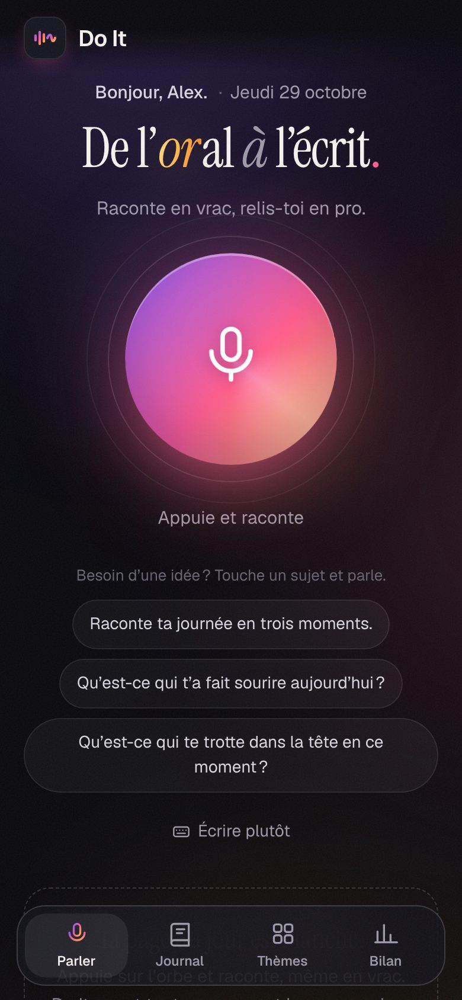
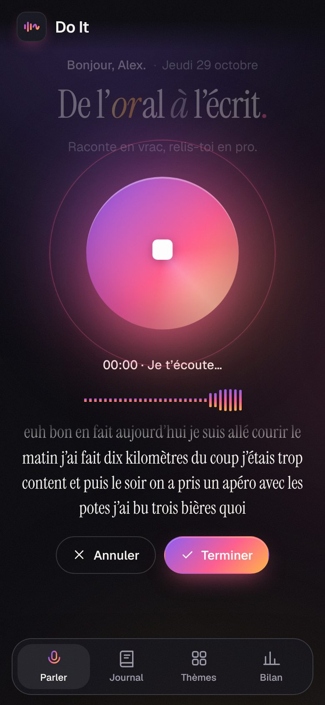
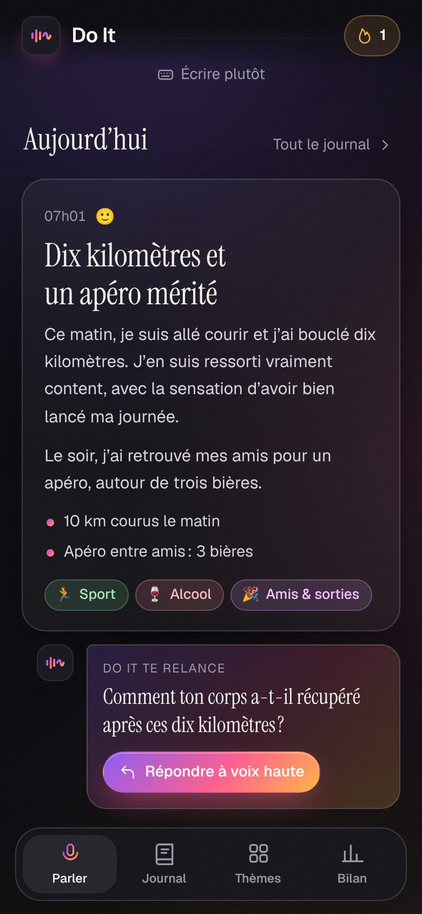
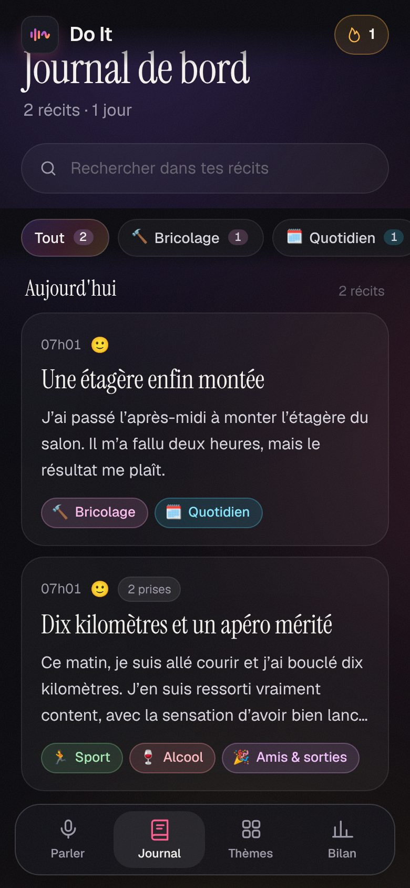
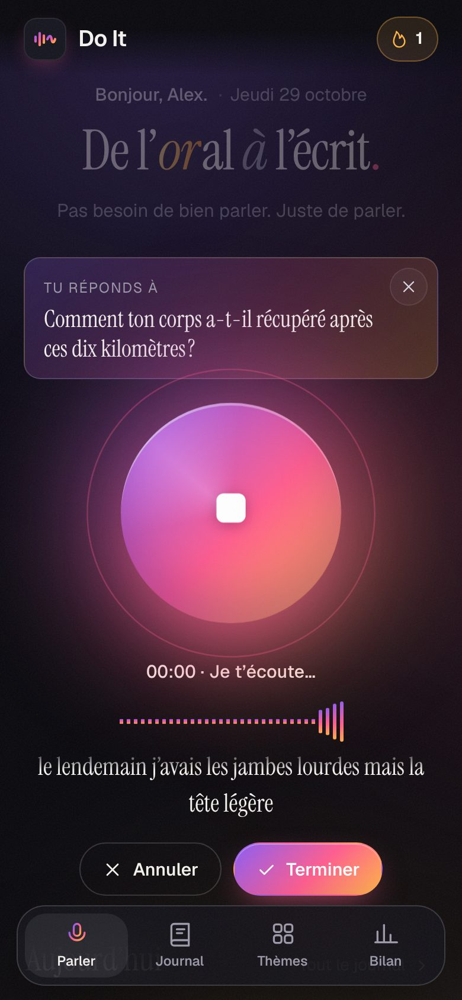
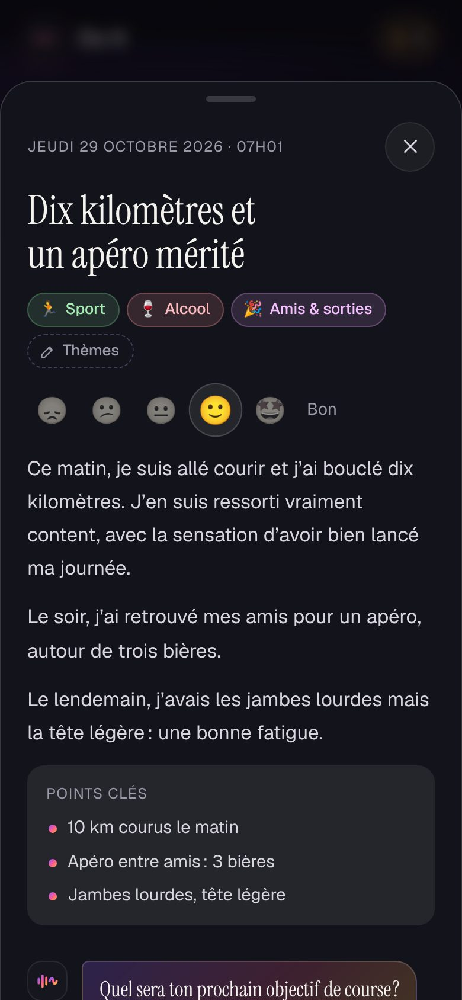
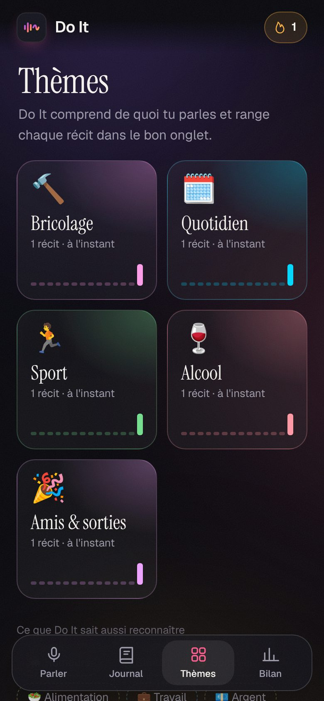
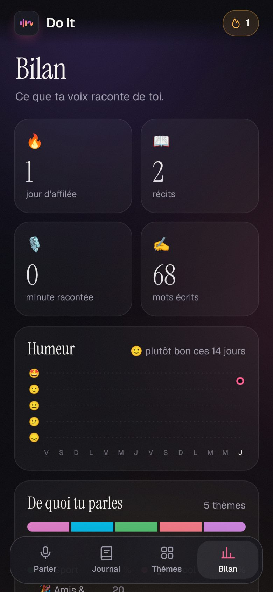

# Do It · De l'oral à l'écrit

> Les paroles s'envolent. **Les tiennes restent.**

Tu appuies sur l'orbe et tu racontes ta journée, ton sport, tes soirées, ton moral, en vrac et comme ça vient. Do It retranscrit ce que tu dis, puis l'IA (Claude) le réécrit en un texte net : grammaire et syntaxe corrigées, « euh », « en fait » et « du coup » supprimés, répétitions et doublons retirés, idées remises dans l'ordre. Chaque récit est daté, titré, résumé et **classé par thème** (Sport, Alcool, Humeurs, Travail…). Au fil des jours, ça devient ton journal de bord.

| Parler | Écoute | Récit écrit | Journal |
| --- | --- | --- | --- |
|  |  |  |  |

| Relance | Fiche | Thèmes | Bilan |
| --- | --- | --- | --- |
|  |  |  |  |

## Ce que fait l'appli

- **Dictée en direct** : les mots s'affichent pendant que tu parles et l'orbe réagit à ta voix. La dictée se relance d'elle-même après un silence, jusqu'à ce que tu appuies sur « Terminer » (20 minutes au plus).
- **De l'oral à l'écrit** : Claude réécrit à la première personne, sans rien inventer. Trois styles au choix (Bilan › Réglages) : *Pro* (prose nette, par défaut), *Récit* (journal intime plus vivant), *Synthèse* (quelques phrases et des points clés).
- **Thèmes automatiques** : 17 thèmes connus (Humeurs, Sport, Alcool, Santé, Sommeil, Alimentation, Travail, Argent, Famille, Amour, Amis & sorties, Projets & objectifs, Loisirs & culture, Voyages, Réflexions, Gratitude, Quotidien). Si tu parles souvent d'autre chose (bricolage, voiture…), l'IA crée le thème et le réutilise ensuite. Chaque thème devient un onglet du journal.
- **Un dialogue** : après chaque récit, Do It te pose une question de relance (« Comment ton corps a-t-il récupéré après ces dix kilomètres ? »). Tu réponds à voix haute et ta réponse est fusionnée dans le même récit, qui est réécrit en entier.
- **Idées de sujet** quand tu sèches, adaptées aux thèmes dont tu parles le plus.
- **Motivation** : phrases d'encouragement, série de jours d'affilée 🔥, paliers fêtés (premier récit, 7 jours, 50 récits…).
- **Bilan** : jours d'affilée, nombre de récits, minutes racontées, mots écrits, courbe d'humeur sur 14 jours, répartition des thèmes.
- **Tout est modifiable** : titre, texte, thèmes, humeur. Tu peux aussi copier, partager, faire réécrire un récit ou le supprimer.
- **Hors-ligne** : sans réseau ou sans IA, Do It nettoie quand même la transcription (tics, répétitions, négations, ponctuation) et la classe par mots-clés. Le récit est marqué « Mode local » puis réécrit automatiquement par l'IA dès qu'elle est de nouveau joignable.
- **Ton journal reste sur ton téléphone** (IndexedDB). Seul le texte dicté part à l'IA, le temps d'être réécrit. Export Markdown, sauvegarde et import JSON dans Bilan › Réglages.
- **Appli installable** (PWA) : « Ajouter à l'écran d'accueil » sur Android et iPhone, sombre ou clair.

## Navigateurs

La dictée utilise la reconnaissance vocale du navigateur, en français :

- **Android** : Chrome. **iPhone / iPad** : Safari (Réglages › Général › Clavier › Dictée doit être activée). **Ordinateur** : Chrome, Edge ou Safari.
- Firefox n'a pas de dictée : Do It propose alors d'écrire au clavier, avec le même traitement par l'IA.
- Sur Chrome, la dictée passe par les serveurs de Google et demande une connexion.

## Mettre en ligne sur Netlify

L'appli est un site statique (`public/`) et une fonction (`netlify/functions/ecrire.mts`, servie sur `/api/ecrire`).

1. Netlify → **Add new project** → **Import an existing project** → ce dépôt.
2. **Base directory** : `apps/do-it`. Le reste est lu dans `netlify.toml` (publication de `public/`, fonctions dans `netlify/functions/`).
3. Déployer. Après le premier déploiement en production, la **passerelle IA de Netlify** fournit l'accès à Claude sans clé à gérer (forfaits Netlify à crédits). La consommation est décomptée de tes crédits Netlify.

Variables facultatives (Project configuration → Environment variables, portée *Functions*) :

| Variable | Rôle |
| --- | --- |
| `DOIT_ACCESS_CODE` | Code demandé par l'appli avant d'utiliser l'IA (à saisir une fois dans Bilan › Réglages). Recommandé si l'adresse du site circule. |
| `ANTHROPIC_API_KEY` | Ta propre clé Anthropic à la place de la passerelle Netlify. |
| `DOIT_MODEL` | Modèle utilisé, `claude-opus-5-5` par défaut. |
| `DOIT_EFFORT` | Effort de réflexion (`low` par défaut, rapide ; `medium` ou `high` pour plus de soin). |

La fonction est limitée à 30 requêtes par minute et par adresse IP. Sans IA (variable absente, passerelle inactive), l'appli fonctionne en mode local.

## Développer

```sh
cd apps/do-it
npm install
npm run serve        # front seul sur http://localhost:4173 (mode local, sans IA)
npm test             # tests unitaires (nettoyage local, dictée, thèmes, validation serveur)
npm run typecheck    # fonction Netlify
npm run smoke        # parcours complet dans Chromium avec dictée et IA simulées
npm run smoke -- --shots   # idem + met à jour docs/screenshots/
```

Avec la CLI Netlify (`netlify dev`), le front et `/api/ecrire` tournent ensemble ; la passerelle IA n'est active qu'après un premier déploiement en production.

```
public/                     l'appli (HTML, CSS, JS sans dépendance ni compilation)
  js/app.js                 états, rendu des vues, interactions
  js/speech.js              dictée (Web Speech API), relance après silence
  js/ai.js                  appel à /api/ecrire, repli sur le mode local
  js/local-ai.js            nettoyage et classement hors-ligne
  js/themes.js              catalogue des thèmes (partagé avec la fonction)
  js/store.js               stockage IndexedDB
  sw.js                     cache hors-ligne
netlify/functions/ecrire.mts  POST : réécriture, thèmes, humeur, relance ; GET : état de l'IA
netlify/lib/ecrire.mts      consigne, schéma de sortie, validation, normalisation
tests/                      tests unitaires et parcours Playwright
```
